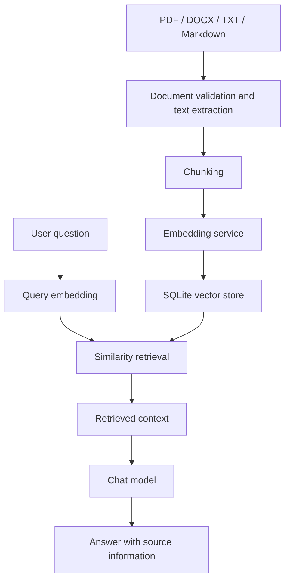

# Enterprise Knowledge Assistant

[](https://github.com/sweetatyagiaz/Enterprise-Knowledge-Assistant/actions/workflows/tests.yml)

A practical Retrieval-Augmented Generation (RAG) application that lets users index documents and ask questions grounded in retrieved passages. The project is built with **FastAPI, OpenAI embeddings, SQLite, and NumPy**.

> **Project status:** Learning and portfolio project. The current implementation is designed for local experimentation and small corpora; it is not presented as a production-hardened, high-scale enterprise service.


## Features

-   REST API documented with Swagger UI.
-   Document upload for PDF, DOCX, TXT, and Markdown files.
-   Text chunking with configurable overlap.
-   Embedding generation using the OpenAI Embeddings API.
-   Local SQLite storage for document chunks and embedding vectors.
-   Cosine-similarity retrieval.
-   Question answering with source information.
-   Basic health and document-listing endpoints.

> This is a learning and portfolio project. The current SQLite/NumPy
> vector search is intended for a small local prototype, not a
> high-scale production deployment.

## Architecture

``` text
Document (PDF/DOCX/TXT/MD)
          |
          v
  Document Loader
          |
          v
    Text Chunking
          |
          v
  OpenAI Embeddings
          |
          v
 SQLite Vector Store
          |
          +----------------------+
                                 |
Question -> Query Embedding -----+
                                 |
                                 v
                      Similarity Search
                                 |
                                 v
                       Retrieved Context
                                 |
                                 v
                       OpenAI Chat Model
                                 |
                                 v
                         Answer + Sources
```

## Project structure

``` text
ai-architect-portfolio/
├── ai_core/
│   ├── __init__.py
│   ├── settings.py
│   ├── chunking.py
│   ├── rag.py
│   ├── vector_store.py
│   ├── embeddings/
│   │   ├── __init__.py
│   │   └── service.py
│   └── ingestion/
│       ├── __init__.py
│       └── loaders.py
├── api/
│   └── main.py
├── tests/
├── data/
├── .env.example
├── .gitignore
├── requirements-app.txt
└── README.md
```

Your local folder structure may contain additional files as the project
develops.


## Main RAG Architecture Components

1. **Document Loader:** Extracts text from PDF, DOCX, TXT, and Markdown documents.
2. **Text Chunking:** Splits document text into smaller, overlapping chunks.
3. **OpenAI Embeddings:** Uses the `text-embedding-3-small` embedding model by default to convert text into 1536-dimensional vectors.
4. **SQLite Vector Store:** Stores document chunks and their embedding vectors in `data/vector_store.sqlite3`.
5. **Similarity Search:** Uses cosine similarity to retrieve the most relevant document chunks for a user question.
6. **Retrieved Context:** Combines retrieved passages to provide context for answering the question.
7. **OpenAI Chat Model:** Uses `gpt-4.1-mini` by default to generate answers grounded in the retrieved context.
8. **FastAPI:** Exposes endpoints for document ingestion, document listing, health checks, and question answering.

### Default Retrieval Configuration

The default number of retrieved chunks is 5 per question (`TOP_K=5`). The application can use a different number when the request explicitly supplies `top_k`.


## Requirements

-   Python 3.10 or newer
-   An OpenAI API key with API access and available billing/credits
-   macOS, Linux, or Windows

## Setup

Run these commands from the project root.

### 1. Activate your virtual environment

If your environment is already activated, skip this step. For example:

``` bash
source venv_django/bin/activate
```

Use the activation command that matches the name and location of your
own virtual environment.

### 2. Install dependencies

``` bash
python -m pip install -r requirements-app.txt
```

If `requirements-app.txt` is not complete yet, install the required
packages:

``` bash
python -m pip install fastapi "uvicorn[standard]" pydantic-settings openai pypdf python-docx numpy python-multipart pytest httpx
```

## Default AI Models

The default embedding model is `text-embedding-3-small`, configured through `EMBEDDING_MODEL`. It generates 1536-dimensional embedding vectors for document chunks and user questions.

The default chat completion model is `gpt-4.1-mini`, configured through `CHAT_MODEL`. It generates answers using the context retrieved from the SQLite vector store.

The project stores document chunks and embedding vectors in SQLite at `data/vector_store.sqlite3`. Retrieval uses cosine similarity and returns 5 chunks by default (`top_k=5`).


### 3. Configure environment variables

Create a local `.env` file:

``` bash
cp .env.example .env
```

If `.env.example` does not exist, create `.env` manually with:

``` dotenv
OPENAI_API_KEY=replace_with_your_openai_api_key
CHAT_MODEL=gpt-4.1-mini
EMBEDDING_MODEL=text-embedding-3-small
EMBEDDING_DIMENSIONS=1536
DATA_DIR=data
SQLITE_PATH=data/vector_store.sqlite3
CHUNK_SIZE=900
CHUNK_OVERLAP=150
TOP_K=5
MAX_UPLOAD_MB=15
```

Replace the placeholder with your real API key. **Never commit `.env` or
expose your API key in source control.**

## Run the API

From the project root:

``` bash
python -m uvicorn api.main:app --reload
```

Open Swagger UI at http://127.0.0.1:8000/docs.

Health endpoint: http://127.0.0.1:8000/health

## Try it

### 1. Upload a document

Using Swagger UI:

1.  Open `/docs`.
2.  Expand `POST /documents`.
3.  Click **Try it out**.
4.  Choose a PDF, DOCX, TXT, or Markdown file.
5.  Click **Execute**.

Or upload this README from the project root using `curl`:

``` bash
curl -X POST http://127.0.0.1:8000/documents \
  -F "file=@README.md"
```

A successful response should include the filename, number of chunks
created, and indexing status.

### 2. Verify indexed documents

Use `GET /documents` in Swagger UI, or run:

``` bash
curl http://127.0.0.1:8000/documents
```

### 3. Ask a question

In Swagger UI, expand `POST /ask` and submit:

``` json
{
  "question": "What are the main components of this project?",
  "top_k": 5
}
```

Or use `curl`:

``` bash
curl -X POST http://127.0.0.1:8000/ask \
  -H "Content-Type: application/json" \
  -d '{"question":"What are the main components of this project?","top_k":5}'
```

The API should return an answer and source information from retrieved
chunks. Actual responses depend on the uploaded document and successful
OpenAI API access.

## API endpoints

  Method   Endpoint       Purpose
  -------- -------------- ----------------------------------------
  `GET`    `/health`      Check API status
  `GET`    `/documents`   List indexed documents and chunk count
  `POST`   `/documents`   Upload and index a document
  `POST`   `/ask`         Ask a question using retrieved context

## Configuration

  ------------------------------------------------------------------------------
  Variable                 Purpose                 Default
  ------------------------ ----------------------- -----------------------------
  `OPENAI_API_KEY`         OpenAI API              Required for model calls
                           authentication          

  `CHAT_MODEL`             Chat completion model   `gpt-4.1-mini`

  `EMBEDDING_MODEL`        Embedding model         `text-embedding-3-small`

  `EMBEDDING_DIMENSIONS`   Embedding vector        `1536`
                           dimensions              

  `SQLITE_PATH`            SQLite database         `data/vector_store.sqlite3`
                           location                

  `CHUNK_SIZE`             Characters per text     `900`
                           chunk                   

  `CHUNK_OVERLAP`          Overlap between chunks  `150`

  `TOP_K`                  Number of retrieved     `5`
                           chunks                  

  `MAX_UPLOAD_MB`          Maximum upload size in  `15`
                           MB                      
  ------------------------------------------------------------------------------

The environment variable names and defaults should match
`ai_core/settings.py`.

## Development checks

Check imports:

``` bash
python -c "from ai_core.rag import KnowledgeAssistant; print('RAG import successful')"
```

Run tests, if the test suite is present:

``` bash
python -m pytest -q
```


## Who this project is for

- **Developers and students** learning how to build a RAG application end to end.
- **AI engineers** exploring document ingestion, chunking, embeddings, retrieval, and answer grounding.
- **Teams evaluating prototypes** before deciding whether to build a larger knowledge-assistant service.

## What you can do

1. Upload a PDF, DOCX, TXT, or Markdown document.
2. Extract and split its text into chunks.
3. Create embeddings and store chunks locally in SQLite.
4. Ask questions against the indexed content.
5. Inspect returned source information and run retrieval/grounding evaluations.

## Quick start

### Prerequisites

- Git
- A Python version supported by the project dependencies
- An OpenAI API key for model calls
- Network access to the configured OpenAI API

### 1. Clone the repository

```bash
git clone https://github.com/sweetatyagiaz/Enterprise-Knowledge-Assistant.git
cd Enterprise-Knowledge-Assistant
```

### 2. Create and activate a virtual environment

Linux/macOS:

```bash
python -m venv .venv
source .venv/bin/activate
```

Windows PowerShell:

```powershell
python -m venv .venv
.venv\Scripts\Activate.ps1
```

### 3. Install dependencies

```bash
python -m pip install --upgrade pip
python -m pip install -r requirements-app.txt
```

### 4. Configure environment variables

Create a local `.env` file based on `.env.example` and set the required values. Never commit `.env` or paste real credentials into issues, logs, screenshots, or pull requests.

### 5. Start the API

```bash
python -m uvicorn api.main:app --reload
```

Then open:

- Swagger UI: <http://127.0.0.1:8000/docs>
- Health check: <http://127.0.0.1:8000/health>

If the documented setup does not work on a clean environment, please open an issue with the operating system, Python version, command run, and sanitized error output.

## Try the API

### Upload and index a document

```bash
curl -X POST "http://127.0.0.1:8000/documents" \
  -F "file=@README.md"
```

### List indexed documents

```bash
curl "http://127.0.0.1:8000/documents"
```

### Ask a question

```bash
curl -X POST "http://127.0.0.1:8000/ask" \
  -H "Content-Type: application/json" \
  -d '{
    "question": "What are the main components of this project?"
  }'
```

The exact request fields and response schema should be checked in Swagger UI (`/docs`) for the version you are running. Answers depend on the indexed documents, retrieval results, model configuration, and external API availability.

## Architecture at a glance



This diagram describes the documented high-level flow. It does not imply that every deployment has production-grade authentication, authorization, OCR, multi-tenant isolation, or a distributed vector database.

## Documentation

- [API examples and endpoint guide](docs/API_REFERENCE.md)
- [Evaluation methodology and recorded results](docs/EVALUATION.md)
- [Local deployment and production-readiness notes](docs/DEPLOYMENT.md)
- [Roadmap](ROADMAP.md)
- [Contributing](CONTRIBUTING.md)
- [Security and vulnerability reporting](SECURITY.md)
- [Community guidelines](CODE_OF_CONDUCT.md)
- [Screenshot and demo checklist](docs/SCREENSHOTS.md)
- [License decision note](LICENSE.DRAFT.md)

## Evaluation and quality

The project has a growing automated test suite and a retrieval evaluation workflow. The latest recorded Sprint 20 run reported **309 passing tests** and a reviewed-relevance evaluation covering **10 answerable cases and 19 chunk labels**. On that reviewed subset, recorded metrics were Precision@5 **0.32**, Recall@5 **0.85**, MRR **0.95**, and nDCG@5 **0.8223**.

These figures describe a specific local evaluation run, not a guarantee of accuracy on arbitrary corpora. Recall is relative to the reviewed labels available for those cases; it is not exhaustive corpus-wide recall. See [the evaluation notes](docs/EVALUATION.md) for interpretation and reproducibility caveats.

## Screenshots and demo

Screenshots should be captured from the real running application and added only after checking that they contain no API keys, private documents, personal data, or other sensitive content. The [screenshot checklist](docs/SCREENSHOTS.md) describes the recommended images.

## Security, privacy, and limitations

- Treat uploaded documents and model responses as potentially sensitive.
- Review the configured model provider's data handling and terms before sending confidential material.
- Do not use real secrets in source control, bug reports, test fixtures, or screenshots.
- Retrieved sources can help users inspect evidence, but citations do not guarantee that every generated claim is correct.
- The current local SQLite/NumPy design is intended for a small prototype. Production use requires a separate security, privacy, performance, reliability, and operational review.
- The repository's current state and actual implemented controls are the source of truth; roadmap items are not implemented features.

## Contributing

Contributions are welcome. Start with [CONTRIBUTING.md](CONTRIBUTING.md), run the test suite before submitting a pull request, and include tests for behavior changes. Please do not commit `tests/data/` evaluation labels or other local/private datasets.

## License

A license has not been selected in this documentation bundle. Review `LICENSE.DRAFT.md` and choose the license that matches your ownership and distribution intentions before publishing the repository as open source. Until an actual license is added, do not assume users have permission to reuse, modify, or redistribute the code.


## Development history: Sprints 1–20

This section records the project's development from the initial RAG prototype through retrieval optimization and reviewed relevance evaluation. It is based on the project notes, evaluation outputs, and Git history available through **29 October 2026**.

> **Sprint-history note:** The commit history contains many small test and fix commits, and not every commit names its sprint. Sprints 1–5 and 17–20 have specific milestone details in the project history. Sprints 6–16 below are chronological, thematic summaries reconstructed from commit subjects; their exact boundaries should not be treated as independently verified sprint planning records. Test counts are stated only where a recorded result is available.

### Sprint 1 — Establish the RAG baseline

**Goal:** Create the initial working foundation for a document-grounded question-answering application.

Completed work:

- Established the FastAPI application and the initial `ai_core` structure for settings, chunking, embeddings, ingestion, retrieval, and RAG orchestration.
- Connected document ingestion to text chunking, embedding generation, local SQLite storage, similarity retrieval, and answer generation with source information.
- Established early vector-store and retrieval checks to validate the main path before adding broader safeguards.
- Defined the core user journey: ingest a document, index its chunks, ask a question, and return an answer grounded in retrieved passages.

**Recorded baseline:** 34 tests passed across the initial test milestone, with 12 retrieval evaluation cases. These are baseline results from the project history, not a claim that the current suite contains only those tests.

### Sprint 2 — Unsupported-answer behavior and abstention

**Goal:** Reduce the risk of answering questions that the indexed evidence cannot support.

Completed work:

- Added and tested behavior for unsupported financial questions, including questions about annual profit.
- Strengthened the distinction between information present in retrieved context and information that is absent from the knowledge base.
- Added a regression check so that an unsupported question does not receive a fabricated financial figure simply because the model can produce a plausible answer.
- Began treating abstention and answer support as explicit quality requirements rather than relying only on whether an answer was generated.

**Recorded result:** 35 tests passed at this milestone.

### Sprint 3 — RAG evaluation and grounding checks

**Goal:** Move from checking whether the API responds to evaluating whether its answers are supported by evidence.

Completed work:

- Expanded the RAG evaluation workflow and its test coverage.
- Added checks for answer grounding, expected references, missing references, and unsupported claims.
- Introduced adversarial and boundary-oriented cases to exercise failure modes that ordinary happy-path questions would miss.
- Improved the ability to distinguish retrieval or execution failures from a completed evaluation that produces an unsupported-answer verdict.

**Recorded result:** 97 tests passed, including evaluation of 18 adversarial cases.

### Sprint 4 — Document ingestion and error-handling hardening

**Goal:** Make ingestion and question answering fail predictably when inputs are malformed or the underlying operation raises an unexpected error.

Completed work:

- Added validation for extracted document text, including empty and whitespace-only content.
- Covered upload-size boundaries, malformed documents, invalid text encodings, empty PDF/DOCX extraction results, and unexpected ingestion exceptions.
- Added protections and tests for unexpected errors during ingestion and question answering.
- Hardened question validation for missing, null, whitespace-only, non-string, and overlong values.
- Added settings and chunking edge-case coverage, alongside API response and error-path tests.
- Produced a semantic grounding evaluation report to record answer-support behavior.

**Recorded results:** 243 tests passed. The semantic evaluation completed all 12 of 12 cases, with 100% supported verdicts and zero execution failures in that recorded run.

### Sprint 5 — Retrieval ranking and paraphrase robustness

**Goal:** Improve the likelihood that the top-ranked retrieved passage actually supports the question, including when the question is phrased differently from the source text.

Completed work:

- Improved hybrid retrieval behavior for paraphrased queries.
- Added validation for ranking scores and edge cases in hybrid ranking and vector-store search.
- Tested empty-retrieval answer quality and cases where relevant evidence was not initially ranked first.
- Added regression coverage around unsupported financial answers and evidence-based claims.

**Recorded results:** 250 tests passed. Across 18 evaluation cases (14 answerable and 4 unanswerable), top-1 evidence retrieval improved from 92.9% to 100% in the recorded comparison. This is an evaluation result for that dataset, not a guarantee for arbitrary documents or questions.

### Sprint 6 — Request validation and API contract coverage

**Focus reconstructed from commit history:** Tighten the API contract so invalid inputs are rejected consistently and valid boundary values remain accepted.

Completed work visible in the commit history:

- Covered missing, null, numeric, Boolean, whitespace-only, and overlong `question` values.
- Tested whitespace around questions and the maximum accepted question length.
- Added validation tests for `top_k`, including string values, negative values, boundary values, and an optional null value.
- Added API endpoint response and error-handling regression coverage.

**Outcome:** The API input contract became more explicit and testable, with both rejection cases and accepted boundaries represented in automated tests.

### Sprint 7 — Upload, document listing, and ingestion response contracts

**Focus reconstructed from commit history:** Exercise document upload and listing behavior at the API boundary.

Completed work visible in the commit history:

- Added document upload validation coverage.
- Tested document listing and ingestion responses.
- Covered malformed uploads and ingestion edge cases, including empty extracted text and invalid encodings.
- Added checks for error responses so ingestion failures are surfaced predictably rather than silently producing invalid indexed content.

**Outcome:** The document-ingestion API received broader regression coverage for success responses, invalid files, and failure paths.

### Sprint 8 — Core-component edge-case testing

**Focus reconstructed from commit history:** Increase reliability by testing the seams between the RAG components.

Completed work visible in the commit history:

- Added edge-case tests for the document loader and preservation of extracted text.
- Added embedding-service edge-case tests.
- Expanded vector-store search and hybrid-ranking edge-case tests.
- Covered RAG evaluation and grounding-evaluator boundary behavior.

**Outcome:** Failures in individual components and interactions between components became easier to detect through targeted tests.

### Sprint 9 — Configuration, chunking, and settings validation

**Focus reconstructed from commit history:** Validate application configuration and text chunking inputs instead of assuming configuration is always valid.

Completed work visible in the commit history:

- Added application-settings validation.
- Added chunking edge-case tests.
- Tested configuration boundaries and invalid settings.
- Continued checking RAG evaluator inputs and missing references.

**Outcome:** Configuration errors and invalid chunking/evaluation inputs received explicit validation paths and regression tests.

### Sprint 10 — Semantic grounding evaluation and reference integrity

**Focus reconstructed from commit history:** Improve evaluation reliability and make evaluation outputs inspectable.

Completed work visible in the commit history:

- Expanded RAG quality evaluation edge-case coverage.
- Tested missing references in evaluation data and invalid evaluator inputs.
- Added a semantic grounding evaluation report (`a4e0570`).
- Distinguished evaluation completion from whether the result supports or rejects a claim.

**Outcome:** Evaluation became more auditable, with a recorded report and more deliberate handling of missing or malformed evaluation references.

### Sprint 11 — Hybrid-ranking score validation

**Focus reconstructed from commit history:** Make ranking behavior robust to invalid or inconsistent score values.

Completed work visible in the commit history:

- Added validation for hybrid retrieval ranking scores.
- Added tests for hybrid-ranking edge cases.
- Improved hybrid retrieval for paraphrased queries (`256844c`).
- Continued regression testing for answer quality when retrieval returns no useful evidence.

**Outcome:** Ranking failures and unexpected score values were treated as explicit edge cases, while paraphrase handling received a targeted improvement.

### Sprint 12 — Financial-claim grounding and unsupported answers

**Focus reconstructed from commit history:** Strengthen the evidence requirements for financial statements and database-related claims.

Completed work visible in the commit history:

- Added tests documenting unsupported financial-answer behavior.
- Added guards for unsupported financial answers (`afc6baa`).
- Added validation for evidence supporting financial metrics (`1f0c33e`).
- Added claim-level grounding regression tests (`cbb053c`).
- Improved grounding for database-related claims (`9709c97`).

**Outcome:** Financial figures and database claims received more targeted grounding controls and regression checks. The objective is to avoid presenting an unsupported value as fact, not to guarantee perfect factuality in every generated answer.

### Sprint 13 — Conflicting configuration and semantic-claim checks

**Focus reconstructed from commit history:** Test cases where multiple values or sources may appear to disagree.

Completed work visible in the commit history:

- Added tests for conflicting configuration values (`90f98d8`).
- Continued claim-level grounding and semantic evaluation hardening.
- Improved the handling of database claims and evidence selection.

**Outcome:** The project gained regression coverage for potentially conflicting evidence/configuration, helping expose cases where the system could select or state the wrong value.

### Sprint 14 — Normalized hybrid ranking and semantic grounding

**Focus reconstructed from commit history:** Improve the comparability of ranking scores and the support for semantic claims.

Completed work visible in the commit history:

- Normalized hybrid retrieval ranking scores (`caa8363`).
- Improved semantic claim grounding (`b0829ad`).
- Continued to use retrieval and grounding regression tests to protect the behavior.

**Outcome:** Ranking scores became more consistent for hybrid ranking, while semantic grounding received a further targeted improvement.

### Sprint 15 — Live API evaluation latency

**Focus reconstructed from commit history:** Measure evaluation performance when requests use the live API path.

Completed work visible in the commit history:

- Added live API evaluation latency measurement (`62c459c`).
- Began tracking runtime as a separate dimension from correctness and grounding.

**Outcome:** The project gained a basis for observing evaluation latency. A latency measurement alone does not establish production throughput or service-level objectives; those require repeated workload-specific benchmarks.

### Sprint 16 — Embedding-cache optimization and invalidation

**Focus reconstructed from commit history:** Reduce repeated embedding parsing and search overhead while keeping cached values consistent with stored data.

Completed work visible in the commit history:

- Cached parsed vector embeddings (`252f1bb`).
- Improved vector-cache invalidation and benchmarking (`367606e`).
- Added tests for cache memory behavior and concurrency (`6738960`).
- Focused on correctness when the underlying document chunks or embeddings change.

**Outcome:** This work established the caching and invalidation foundation for the later binary-embedding and vectorized-search optimization. The cache must be invalidated when indexed data changes to prevent stale retrieval results.

### Sprint 17 — Binary embeddings and vectorized similarity search

**Goal:** Reduce the overhead of loading embeddings and improve local vector-search performance.

Completed work:

- Added binary embedding storage while retaining compatibility with existing JSON-encoded embedding rows.
- Implemented vectorized cosine-similarity and top-k search rather than relying only on repeated per-row operations.
- Added cache revision/invalidation behavior so writes to the chunk table trigger a refresh of cached search data.
- Added performance benchmarks and tests for memory behavior and concurrency.
- Kept compatibility with the existing SQLite-based vector-store interface.

**Recorded result:** 273 tests passed at the Sprint 17 milestone. The recorded benchmark results were:

| Vector count | Cold search | Warm median |
|---:|---:|---:|
| 1,000 | 18.58 ms | 0.17 ms |
| 5,000 | 91.79 ms | 0.59 ms |
| 10,000 | 234.03 ms | 1.92 ms |

These are results from the recorded benchmark environment; they should not be interpreted as guaranteed timings on different hardware or workloads.

### Sprint 18 — Retrieval ranking metrics

**Goal:** Add standard metrics for evaluating ranked retrieval results.

Completed work:

- Added Precision@K.
- Added Recall@K.
- Added Mean Reciprocal Rank (MRR).
- Added normalized Discounted Cumulative Gain (NDCG@K).
- Kept the metric functions separate from production ranking so evaluation can measure ranking quality without changing the ranking algorithm itself.

**Outcome:** Retrieval evaluation could move beyond checking whether a source appears in the result set and begin measuring the relevance and position of retrieved candidates.

### Sprint 19 — Structured retrieval evaluation reports

**Goal:** Make retrieval evaluation repeatable, inspectable, and easier to compare between runs.

Completed work:

- Added a structured retrieval-report builder (`704edf7`).
- Evaluated a dataset containing 18 cases: 14 answerable and 4 unanswerable.
- Reported source hit rate, keyword-evidence rates, and keyword-proxy ranking metrics.
- Kept keyword matching explicitly identified as a proxy rather than human-reviewed relevance.
- Saved a timestamped JSON evaluation report (`651ac12`).

**Recorded result:** The project history records 297 tests passing at the Sprint 19 stage. The evaluator reported, for answerable cases, 100% source hit rate and 100% keyword-evidence rates at ranks 1 and K. Keyword-proxy metrics were reported separately from reviewed relevance.

### Sprint 20 — Reviewed chunk-level relevance evaluation

**Goal:** Add human-reviewed chunk labels as a separate retrieval-quality signal without changing production ranking or the database schema.

Completed work:

- Added `ai_core/evaluation/reviewed_relevance.py` to load reviewed labels, validate them, and calculate Precision@K, Recall@K, MRR, and NDCG@K.
- Added `tests/test_reviewed_relevance.py` to cover metric calculations, missing/unreviewed labels, duplicate cases and chunk IDs, invalid grades, missing chunk IDs, filename mismatches, and evidence-term mismatches.
- Updated `tests/evaluate_retrieval.py` to validate labels against the current SQLite index before evaluation.
- Extended `ai_core/evaluation/retrieval_report.py` to summarize reviewed metrics separately from keyword-proxy metrics.
- Included reviewed relevance grades in the retrieved-chunk details where labels are available.
- Kept unanswerable cases out of reviewed relevance scoring; they require separate abstention-quality evaluation.
- Kept `tests/data/` excluded from GitHub as requested. The local label file contains 10 reviewed cases and 19 relevant-chunk labels.
- Saved a timestamped JSON report at `reports/evaluations/retrieval_evaluation_20261029T055334Z.json`.

**Recorded result:** 309 tests passed. The evaluation validated 10 reviewed cases and 19 labels against 23 currently indexed chunks. Across the 10 labeled answerable cases, the report recorded:

| Reviewed metric | Result |
|---|---:|
| Precision@5 | 0.3200 |
| Recall@5 | 0.8500 |
| MRR | 0.9500 |
| NDCG@5 | 0.8223 |

Recall is relative to the known labeled relevant chunks. Because the label dataset is not guaranteed to enumerate every relevant chunk in the corpus, the result is not an exhaustive measure of corpus-wide recall. Chunk IDs may change after re-indexing, so the evaluator validates the IDs and evidence terms before computing metrics.

**Git milestone:** `a984f5c feat: add reviewed chunk-level retrieval evaluation`, committed and pushed to `main` on 29 October 2026.

### Overall outcome after Sprint 20

By the end of Sprint 20, the project had progressed from a minimal document-grounded RAG workflow to a more thoroughly tested and measurable local application. The main completed capabilities are:

- Document ingestion for PDF, DOCX, TXT, and Markdown.
- Configurable chunking and embedding generation.
- SQLite-backed vector storage with cosine-similarity retrieval.
- Hybrid ranking and paraphrase-related ranking improvements.
- Source-aware question answering and safeguards for unsupported financial claims.
- API and ingestion validation with extensive edge-case regression tests.
- Semantic grounding evaluation and live API latency measurement.
- Cached and binary embedding paths, vectorized search, and cache invalidation.
- Standard retrieval metrics and structured, timestamped JSON evaluation reports.
- A separate reviewed chunk-level relevance evaluation layer.

The most recent recorded suite contains **309 passing tests**. The current architecture remains a local prototype: authentication, per-document authorization, production deployment hardening, comprehensive observability, and a scalable vector index remain future work.

## Current limitations and next steps

Before using this as a production service, add and test:

-   Authentication, authorization, and per-document access controls.
-   File-content validation and robust upload limits.
-   Better PDF extraction, OCR for scanned documents, and handling of
    tables.
-   Automated evaluation for retrieval relevance and answer grounding.
-   Structured logging, latency metrics, tracing, and cost monitoring.
-   Rate limiting, timeouts, retries, and safe error handling.
-   A scalable vector database/index if the corpus or traffic grows.
-   Deployment configuration, CI, and security tests.

## Learning objectives

This project demonstrates the core RAG flow:

1.  Ingest documents.
2.  Split text into overlapping chunks.
3.  Generate embeddings.
4.  Store and retrieve vectors.
5.  Build context from retrieved passages.
6.  Generate an answer grounded in that context.
7.  Evaluate retrieval quality, answer faithfulness, latency, and cost.

------------------------------------------------------------------------

**Project:** AI Architect Portfolio --- Sprint 1\
**Component:** Enterprise Knowledge Assistant
